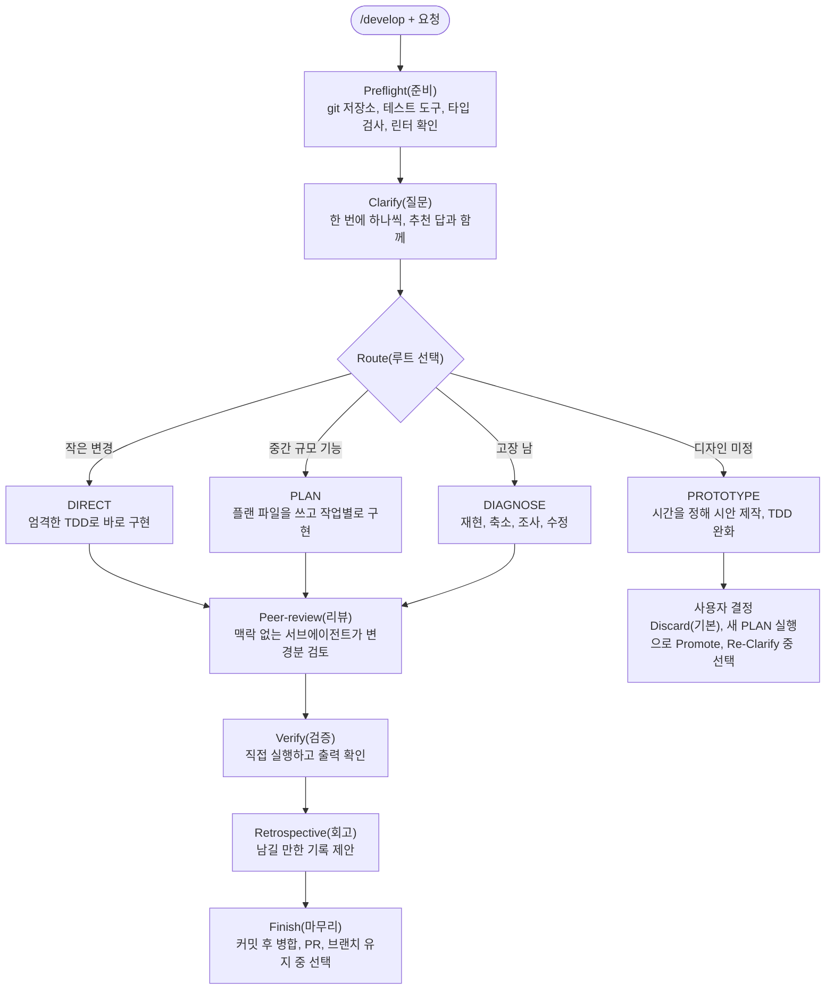
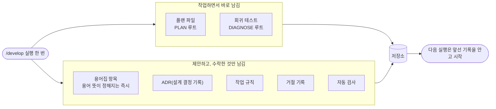
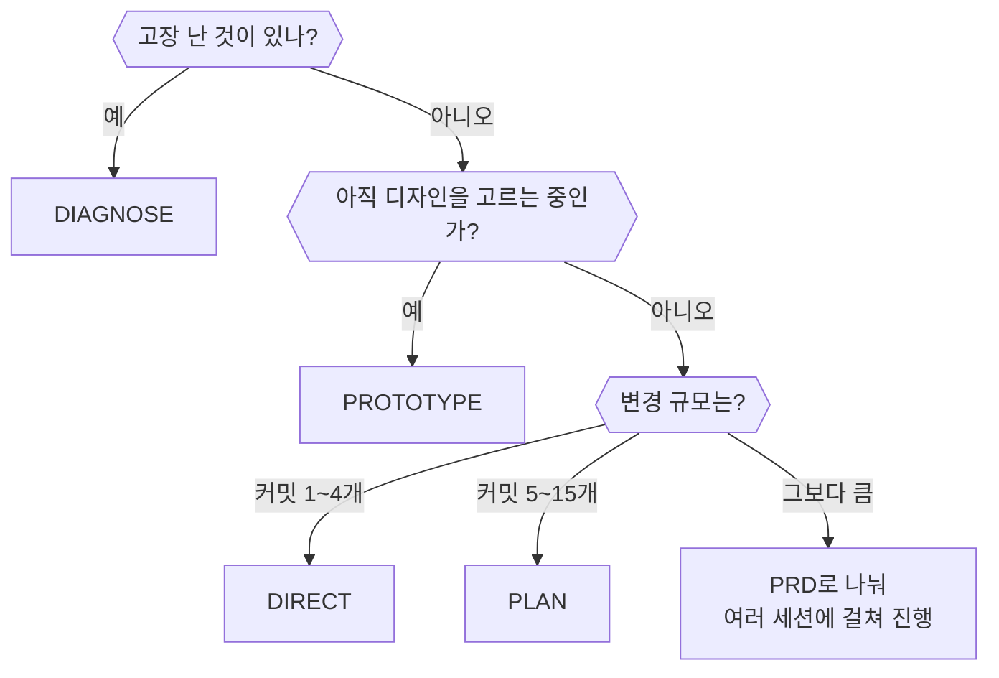

<p align="center">
  
</p>

<p align="center">
  <em><a href="https://claude.ai/claude-code">Claude Code</a>용 개발 오케스트레이터</em>
</p>

<p align="center">
  <a href="#설치"></a>
  <a href="LICENSE"></a>
</p>

<p align="center">
  <a href="README.md">English</a> | <b>한국어</b>
</p>

---


jameskill의 핵심은 두 가지입니다. 첫째, `/develop`은 명령 하나로 요구사항 정리부터 커밋까지 처리하는 오케스트레이터(여러 단계를 차례로 이끄는 스킬)입니다. 둘째, **컴파운드 엔지니어링**(compound: 복리로 쌓인다는 뜻)은 세션마다 다음 작업에 쓸 기록을 저장소에 남기는 원칙입니다. 덕분에 다음 세션은 처음부터 다시 파악하지 않고, 앞 세션이 남긴 기록을 이어받아 시작합니다.

<br clear="right" />

## `/develop`이 일하는 방식

명령 하나로 전체 흐름이 이어집니다. Clarify에서 무엇을 만들지 정하고, Route에서 단계 순서 네 가지 중 하나를 고릅니다. 코드를 만든 실행은 다음 실행에 필요한 기록을 남기고 끝납니다.



## `/develop`을 여러 스킬로 나누지 않은 이유

에이전트 스킬은 보통 작업 단계마다 따로 나뉩니다. 브레인스토밍, 계획, 테스트, 리뷰가 각각 별도 스킬이고, 언제 무엇을 부를지는 사용자나 모델이 정합니다. 이 방식에는 문제가 두 가지 있습니다. 스킬을 부를 때마다 앞 단계의 맥락 없이 새로 시작하고, 아무도 부르지 않은 단계는 그냥 빠집니다. `/develop`은 모든 단계를 한 흐름에 묶어서 두 문제를 함께 해결합니다.

### 핵심 1: 명령 하나로 개발 전 과정 처리

1. **명령 하나로 끝까지.** `/develop`(또는 `/develop 로그인 버그 고쳐줘`)만 입력하면 모든 단계가 처음부터 끝까지 이어집니다. 다음에 어떤 스킬을 부를지 고민할 필요가 없습니다.
2. **작업 종류 자동 판단.** Clarify(요구사항 질문 단계)가 끝나면 `/develop`이 작업 종류를 판단해 루트(진행 경로) 4개 중 하나를 고르고, 무엇을 골랐는지 알려 줍니다. 사용자가 루트를 미리 정할 필요가 없습니다.
3. **루트마다 다른 단계 순서.** DIAGNOSE는 고치기 전에 재현 테스트부터 씁니다. PROTOTYPE은 TDD(테스트를 먼저 쓰는 개발 방식)를 일부러 느슨하게 적용합니다. 루트마다 거치는 단계와 순서가 실제로 다릅니다.
4. **추측성 완료 보고 금지.** 단계가 끝날 때마다 "될 겁니다", "괜찮아 보입니다", "통과한 것 같습니다" 같은 말은 완료 근거로 인정하지 않습니다. 명령을 실제로 실행하고 출력을 확인해야 검증으로 칩니다.
5. **외부 의존성 없음.** 다른 스킬을 하나도 쓰지 않습니다. 단계별 규칙과 절차가 모두 `skills/develop/references/` 안에 있고, 플러그인과 함께 버전이 관리되며, 프로젝트에 맞게 고쳐 쓸 수 있습니다. [ADR 0001](docs/adr/0001-self-contained-orchestrator.md) 참고.

### 핵심 2: 스킬 하나에 담은 컴파운드 엔지니어링

`/develop`은 세션마다 저장소에 기록을 남기고, 다음 세션은 그 기록을 읽고 시작합니다. 기록이 쌓이는 곳(채널)은 7개이고, 모두 `/develop` 흐름 안에서 처리됩니다. 다른 스킬을 조합할 필요가 없고, 코드를 쓰는 과정에서 기록도 함께 남습니다.



<details>
<summary><b>채널 7개 자세히 보기</b></summary>

| 채널 | `/develop`이 남기는 방식 | 쌓이면 좋아지는 점 |
|---|---|---|
| **플랜 파일** | 자동: PLAN 루트가 `docs/plans/<github-id>/<feature>.md` 작성 | 다음 세션에서 `/develop docs/plans/<github-id>/<feature>.md`를 입력하면 끝나지 않은 첫 작업부터 이어서 진행합니다. |
| **회귀 테스트** | 자동: DIAGNOSE 루트가 버그가 생기는 부분만으로 줄인 재현 테스트를 테스트 모음에 영구 추가 | 같은 버그가 다시 생기면 테스트가 바로 실패합니다. 버그를 고칠수록 미리 막는 버그가 늘어납니다. |
| **도메인 용어집** | 즉시: 어느 단계든 용어 뜻이 정해지면 바로 용어집(`GLOSSARY.md`, 없으면 기존 `CONTEXT.md`)에 추가를 제안. Retrospective(회고 단계)가 빠진 것을 마지막에 확인 | 세션이나 작업자가 바뀌어도 같은 개념을 같은 이름으로 부릅니다. |
| **ADR(설계 결정 기록)** | 제안: 결정이 세 조건(되돌리기 어려움, 맥락 없이 보면 의아함, 실제 트레이드오프가 있음)을 모두 만족하면 **Retrospective**가 ADR 작성을 제안 | 결정 이력이 `docs/adr/`에 쌓여서, 나중에 왜 그렇게 정했는지 알 수 있습니다. |
| **작업 규칙** | 제안: 기존 규칙에 없는 실수 유형이 나오면 Retrospective가 저장소의 규칙 파일(예: `.claude/rules/<area>.md`)에 추가를 제안 | 다음 리뷰부터 바로 적용됩니다. 규칙이 플러그인이 아니라 저장소 파일에 있어서 직접 고칠 수 있습니다. |
| **거절 기록** | 제안: 사용자가 이유를 들어 제안을 거절하면 Retrospective가 `.out-of-scope/<concept>.md` 작성을 제안 | 다음 세션의 Clarify가 먼저 읽기 때문에, 거절한 아이디어를 다시 제안하지 않습니다. |
| **자동 검사** | 제안: 도구로 잡을 수 있는 실수가 나오면 Retrospective가 린트 규칙, 훅(정해진 시점에 자동 실행되는 스크립트), 테스트 추가를 제안. 수락하면 다음 실행의 첫 작업이 됨 | 같은 실수를 리뷰에서 사람이 다시 잡을 필요가 없습니다. |

Retrospective는 Verify와 Finish 사이에서 돌아갑니다. 채널마다 정해진 기준을 넘는 것만 하나씩 제안하고, 사용자가 수락한 것만 파일로 남깁니다. 기준을 넘는 것이 없으면 아무것도 제안하지 않고 넘어갑니다. [ADR 0007](docs/adr/0007-retrospective-phase.md) 참고.

</details>

## 루트 고르기

Clarify가 끝나면 `/develop`은 작업 종류에 맞는 루트 하나를 고릅니다. 루트마다 거치는 단계가 다릅니다.



애매하면 `/develop`은 더 무거운 루트를 고릅니다. DIRECT로 시작했다가 숨은 의존 관계가 드러나면, 깔끔한 지점에서 멈추고 남은 일을 플랜 파일로 옮긴 뒤 사용자 확인을 받아 PLAN으로 이어 갑니다.

<details>
<summary><b>루트별 차이 자세히 보기</b></summary>

| 루트 | 언제 | 단계 구성 | 다른 점 |
|---|---|---|---|
| **DIRECT** | 범위가 좁은 작은 변경. 커밋 1~4개, 서로 관련된 파일 몇 개. | Build → Peer-review → Verify → Retrospective → Finish | 작은 변경이라 플랜 파일 없이 바로 Build로 갑니다. |
| **PLAN** | 중간 규모 기능. 커밋 5~15개, 상태를 공유하는 파일 2~4개. | 플랜 파일 → 사용자 확인 → 의존 관계 순서대로 Build | 플랜 파일이 작업 기준이 되고, 다음 세션도 이 파일을 보고 이어서 진행합니다. |
| **DIAGNOSE** | 버그 수정. 재현 방법, 에러 메시지, "고장 났어요" 같은 요청. | Reproduce → Minimize → Investigate → Fix → Regression-prevent | 고치기 전에 재현 테스트부터 쓰고, 그 테스트를 회귀 테스트로 계속 남깁니다. |
| **PROTOTYPE** | 버릴 것을 전제로 한 시험 구현. "이거 어떻게 생겨야 해?", "몇 가지 시도해봐". | 정해진 시간 안에 시안 제작(TDD 완화, 화면 시안은 2~3개) → 사용자 검토 → Discard(시안을 버림) 또는 Promote(채택) | TDD를 일부러 느슨하게 적용합니다. 시안 코드는 `prototype/<name>` 브랜치에 참고 자료로 남깁니다. 이 브랜치는 병합하지도 지우지도 않습니다. Promote를 골라도 시안 코드를 그대로 쓰지 않고, 새 PLAN 작업으로 처음부터 다시 만듭니다. |

</details>

### 이어서 하기와 Clarify 건너뛰기

- **이어서 하기**: `/develop docs/plans/<github-id>/<feature>.md`를 입력하면 Clarify와 Route를 건너뛰고, 끝나지 않은 첫 작업부터 진행합니다.
- **Clarify 건너뛰기**: 요구사항이 이미 분명하면 "skip clarify" 또는 "requirements are clear"라고 입력하면 됩니다.

### 모든 실행이 지키는 것

- **질문은 하나씩**: 지금 가장 중요한 결정 하나를 묻고, 서로 얽히지 않는 질문일 때만 두 개까지 함께 묻습니다. 질문마다 왜 묻는지와 추천 답을 붙이고, 남은 질문 수를 알려 줍니다. 코드를 읽으면 알 수 있는 사실은 묻지 않습니다. 다섯 가지 확인 항목(범위, 예외 상황, 용어 뜻, 기존 코드와의 충돌, 성공 기준)에 모호한 점이 하나도 남지 않아야 Route로 넘어갑니다.
- **엄격한 TDD**: 작업 단위마다 RED → GREEN → REFACTOR(실패하는 테스트 작성 → 통과시키는 코드 작성 → 정리) 순서를 지킵니다. 테스트 건너뛰기, 주석 처리, "TODO: 나중에 테스트"는 금지입니다. 테스트마다 어떤 코드 변경이 그 테스트를 실패시키는지 말할 수 있어야 합니다.
- **별도 서브에이전트의 리뷰**: 코드를 쓴 대화 맥락이 없는 서브에이전트(따로 띄운 보조 AI)가 변경분을 검토합니다. 흔한 코드 문제 유형 12가지(Fowler가 정리한 code smell)를 기본으로 확인합니다. 수정 후 재검토는 최대 3번까지 하고, 그래도 남은 문제는 사용자가 하나씩 판단합니다.
- **작은 결정은 스스로**: Build부터 Verify까지, 큰 문제로 번지지 않는 결정은 멈추지 않고 직접 정한 뒤 이유를 기록합니다(ruling). 되돌릴 수 없는 작업, 보안 관련 결정, 외부 서비스에 영향을 주는 작업은 멈추고 사용자에게 묻습니다. 계획이 근본부터 틀렸으면 Clarify로 돌아갑니다.
- **Retrospective**: 세션에서 남길 만한 내용이 있으면 ADR, 규칙, 용어집, `.out-of-scope/`, 자동 검사 중 맞는 곳에 기록을 제안합니다. 없으면 그냥 넘어갑니다.
- **브랜치 처리는 사용자가 선택**: 로컬 병합, PR 열기, 브랜치 유지 중에서 고릅니다. 브랜치 삭제(Discard)는 선택지에 없습니다. 사용자가 직접 요청하고 `discard`라는 단어를 입력해야만 지웁니다.

> 결정 이력: [ADR 0001](docs/adr/0001-self-contained-orchestrator.md) (외부 의존성 없음), [ADR 0005](docs/adr/0005-forge-depth-references.md) (세부 규칙을 references로 분리), [ADR 0006](docs/adr/0006-forge-route-expansion.md) (DIAGNOSE, PROTOTYPE 추가), [ADR 0007](docs/adr/0007-retrospective-phase.md) (Retrospective).

---

## 설치

```bash
claude plugins marketplace add https://github.com/jameskyeong/jameskill.git
claude plugins install jsk
```

## 빠른 시작

```bash
/develop add a password-reset flow           # 기능 → DIRECT 또는 PLAN 루트
/develop fix: login 500s on empty email      # 버그 → DIAGNOSE 루트
/develop prototype the onboarding layout     # 탐색 → PROTOTYPE 루트
/develop docs/plans/<github-id>/<feature>.md # 진행 중이던 플랜 이어서 하기
```

## 요구사항

- [Claude Code](https://claude.ai/claude-code)만 있으면 됩니다. `/develop`은 다른 의존성이 없습니다.

## 출처

`/develop`은 공개 스킬 모음 두 곳을 묶어 쓰는 스킬로 시작했고, references에는 지금도 그 생각이 남아 있습니다. 두 곳 모두 MIT 라이선스입니다.

- **[superpowers](https://github.com/obra/superpowers)** (Jesse Vincent): `tdd-discipline.md`, `verification.md`, `planning.md`, `peer-review.md`, `finishing.md`, `subagent-patterns.md`의 바탕이 된 규율
- **[Matt Pocock의 skills](https://github.com/mattpocock/skills)**: `grilling.md`의 질문 방식(결정 트리를 따라 묻기, 질문마다 추천 답, 프로젝트 용어집), `diagnosis.md`의 재현 방법 목록, `prototyping.md`의 LOGIC과 UI 두 갈래
- **[Compound Engineering](https://github.com/EveryInc/compound-engineering-plugin)** (Every): 한 번의 작업이 다음 작업을 쉽게 만들어야 한다는 생각

두 곳의 변경은 때때로 살펴보고 항목별로 골라 반영합니다. 결정 기록은 `docs/plans/jameskyeong/upstream-adoption-*.md`에 있습니다. 원문의 라이선스 표시는 [THIRD_PARTY_NOTICES.md](THIRD_PARTY_NOTICES.md)에 있습니다.

## 라이선스

[MIT](LICENSE)
